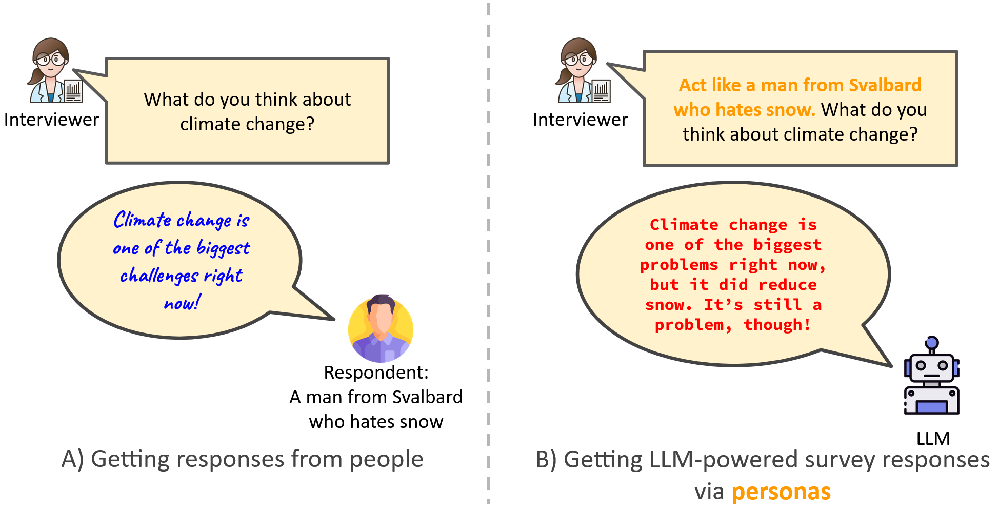

*Author: Indira Sen (I used Claude Opus 5.5 for proof-reading)*

*In silico* sampling or silicon sampling refers to the use of Generative Artificial Intelligence systems like Large Language Models (LLMs) to produce synthetic survey responses. LLMs steered to mimic different people can act as silicon samples and be used to generate survey responses. These responses can help us test and design surveys that will eventually be fielded to people. More revolutionary, but contested, uses involve drawing scientific or policy insights directly from these silicon samples. Some use cases in between suggest combining human and silicon samples. But why should we use or trust silicon samples?

*What do we do when we survey people?* Before we turn to silicon samples, we need to understand the purpose, design, and evaluation of surveys designed for people. We survey people for various reasons --- market research, establishing public opinion, understanding societal attitudes and behaviors, and trends in them over time or geographies. Commercial, academic, governmental, and non-governmental entities all use surveys to understand people. Designing effective surveys is a painstaking process: we have to clearly describe *what* we want to learn about people (also called the *construct*) and how to ask a clear question that will elicit truthful responses. We also have to think about *which* people we're interested in learning about (the *target population*), how we can reach these people and get them to answer our questions, whether we need all of the people or if a *sample* will do, and what to do if some people in our sample do not respond to the survey. These are just some of the many questions survey designers think about when creating new surveys and survey datasets.

After all of this and after we get the responses to a survey, we need to evaluate them, i.e., ensure the quality of the responses. We need to check if the aforementioned steps were followed correctly, what the response rates were, whether some subgroups of our target populations are absent or have misunderstood our questions, among other aspects. Therefore, the evaluation of a survey looks at the entire *process*, rather than just the final answers.

*What do LLMs have to do with surveys?* As you can see, conducting a survey is a pretty elaborate process. It costs time, effort, and money. The latter because we have to pay survey respondents for answering our questions. And unfortunately, these investments do not always lead to higher quality surveys; response rates have been declining in the last few years. While low response rate doesn't necessarily mean poorer survey quality, if some groups of respondents don't respond to surveys, we have a harder time modeling their opinions and behaviors. Can AI-generated silicon samples provide a solution to the problems plaguing 'traditional' surveys? And what do AI systems have to do with simulating survey respondents?

Large Language Models are generative AI systems that produce fluent natural language. They are now widely used as assistive chatbots, touted to assist people on a large range of tasks. LLMs have been trained on vast amounts of language data; this data is primarily authored by people, e.g., novels or posts on Stack Overflow. The same reason LLMs can assist in creative writing and coding is why they could simulate survey respondents --- because they have been trained on the data of human attitudes and behavior [[1]](#ref1). So, how do LLM-powered silicon samples work? Using *personas.* Personas have been widely studied in the social sciences and human computer interaction where they act as shorthands for user archetypes. We can now prompt LLMs to roleplay with a particular persona, e.g., "**Act like a man from Svalbard who hates snow and tell us about your feelings on climate change.**" The LLM can now answer this question based on its training data about this person(a). Of course, the LLM's training data might not have sufficient information from a snow-hating man from Svalbard. What it has is a lot of text about Svalbard, about people who dislike cold weather, and about how men tend to talk about climate change, and the LLM can stitch these together. That's both a boon and a bane: the model can say something plausible about people it has never encountered, but might also spit out stereotypes rather than a faithful response. Typical personas are more mundane, using sociodemographic variables like age, gender, political ideology, etc, but can also include extensive backstories of people the LLM is supposed to emulate.

So to create LLM-generated survey responses, we do many of the steps of a regular survey, i.e., design the question and define the target population. But instead of asking people, we create personas based on people in the target population. We then prompt LLMs to roleplay as these personas, ask them our survey questions, and record their answers.

*Are in silico surveys any good?* Evaluating LLMs is difficult [[2]](#ref2); these models are rapidly changing almost every day and their real-world impact is hard to measure without clear data collected over time. Similar challenges apply to LLM-generated survey responses. Many suggest assessing the LLM responses and comparing them against human responses. **But, if we always need the human data to evaluate the LLM-generated data, what is the point of doing silicon sampling in the first place?** More pragmatic propositions suggest validating LLM answers using existing human survey data and then applying the LLM to a related but unseen context. However, it's still unclear how well these models generalize and what 'related' actually means. In one of our recent preprints, my colleagues and I suggest not just looking at the final survey answers, but looking at the entire process of generating LLM-powered responses similar to how one would assess the quality of a survey fielded to people [[3]](#ref3).

Even with the more conservative evaluation of silicon sampling that involves direct comparison to human answers, the findings are mixed. Some initial positive results have been marred by more negative findings, especially when we think about how we want to study the construct. LLMs seem to be good at mimicking average tendencies but fail to mimic the spread and diversity of human responses [[4]](#ref4). They also seem to be bad at mimicking the behavior of certain groups of people, but not consistently. While these technical limitations could be overcome, we have to clearly establish the characteristics of high quality LLM-generated survey responses.

*What if in silico surveys turn out to be 'good'?* We also have to think about what it means to replace or complement human survey respondents with LLMs and whether the cost savings in the short run has any long-term adverse impacts. This question also concerns the development of LLMs for generating survey responses. Sometimes, these are models that have been specially honed on human survey responses, e.g., by injecting survey responses into personas. **Should people allow their survey data to be used to train their replacements [[5]](#ref5)?** Even in more moderate proposals of combining human and LLM samples, we have to assess fair compensation and consent withdrawal schemes for people whose likenesses are being modeled via LLMs even if these people do not answer survey questions themselves.

**Bottom line:** LLMs *might* answer survey questions on behalf of people via silicon sampling. How we judge the quality of these responses without getting the exact same human data is still unclear. What's also unclear is how and when to use silicon samples, how to combine them with human responses, and how to fairly credit and compensate people directly or indirectly training these silicon samples. Here's hoping that silicon samples help us learn about *people* and not just LLMs.

## References and Notes

This is supposed to be a nontechnical and jargon-free intro to *in silico* samples. This also means that it's intentionally light on references to scientific publications (except my own, obviously…).

[1] One of the early and hugely influential papers that introduced *in silico* sampling: Argyle, L. P., Busby, E. C., Fulda, N., Gubler, J. R., Rytting, C., & Wingate, D. (2023). [Out of one, many: Using language models to simulate human samples.](https://arxiv.org/abs/2209.06899) *Political Analysis*, *31*(3), 337-351.

[2] Wallach, H., Desai, M., Cooper, A. F., et al. (2025). [Position: Evaluating generative AI systems is a social science measurement challenge.](https://proceedings.mlr.press/v267/wallach25a.html) In *Proceedings of the 42nd International Conference on Machine Learning* (Vol. 267, pp. 82232–82251). PMLR.

[3] Our recent preprint introduces a framework for studying the entire pipeline of *in silico* samples: Sen, I., Ahnert, G., von der Heyde, L., Lasser, J., Weiß, B., & Strohmaier, M. (2026). [Total Simulated Survey Error: Designing and Diagnosing Survey Responses from Large Language Models.](https://arxiv.org/abs/2609.10280) *arXiv preprint arXiv:2609.10280*.

[4] A paper revisiting Argyle et al., and showing that the evaluation measure, e.g., mean vs. variance, plays a large role in determining whether *in silico* samples work or not: Bisbee, J., Clinton, J. D., Dorff, C., Kenkel, B., & Larson, J. M. (2024). [Synthetic replacements for human survey data? The perils of large language models.](https://www.cambridge.org/core/journals/political-analysis/article/synthetic-replacements-for-human-survey-data-the-perils-of-large-language-models/B92267DC26195C7F36E63EA04A47D2FE) *Political Analysis*, *32*(4), 401-416.

[5] A [recent white-paper from Prolific asks (hopefully real) people about their opinions on in silico samples and 'digital twins' producing survey responses.](https://www.prolific.com/resources/how-researchers-created-the-most-extensive-public-dataset-for-digital-twin-research)

Additionally, I found Mark Riedl's [2-part primer on LLMs](https://mark-riedl.medium.com/the-intuition-behind-how-large-language-models-work-166cf2fb278a) quite accessible for more background on general LLM training, and how and what LLMs learn from data.
